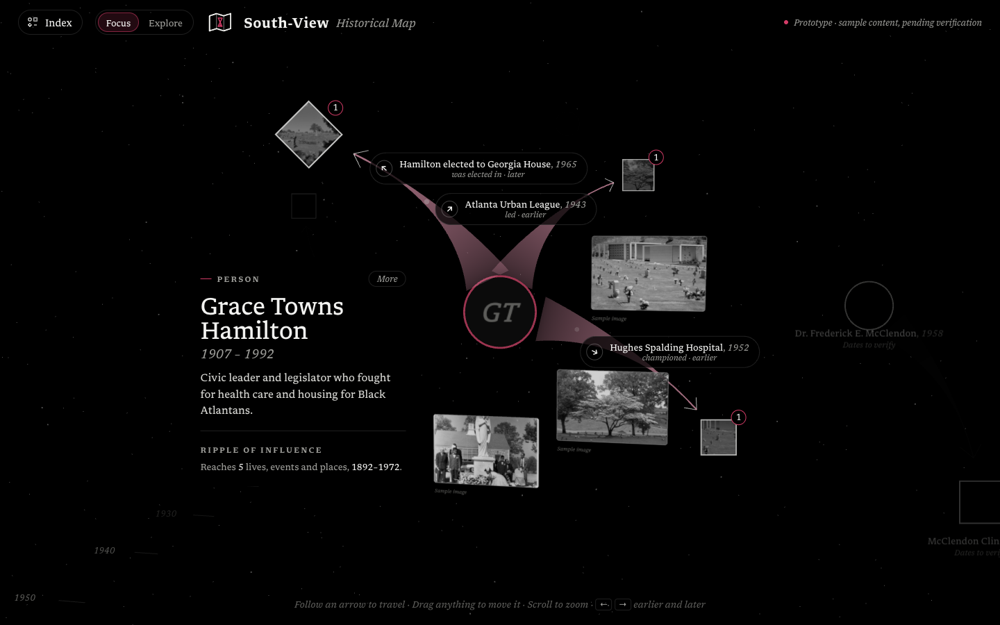

# South-View Historical Map

A 3D map of the people, events and places connected to Historic South-View Cemetery in Atlanta. An LMC 3403 project by Krishna, Lucas, Grant and Matthew.

**Live:** https://south-view-historical-map.vercel.app

> **Prototype.** Every person, event and connection comes from the team's research notes, quoted word for word with the page from Henderson's *South-View: An African American City of the Dead*. South-View keeps the content up to date in a Google Sheet: see [docs/MAINTENANCE.md](docs/MAINTENANCE.md).



## How to read it

- **Time is depth.** Each item sits at its year. Recent years are closest to you; older ones sit further back.
- **Reduce motion** (top bar) turns off every animation and lays the map out flat as a 2D graph: time runs left to right, with a decade rail along the bottom. Everything else works the same (Focus, Explore, arrows, cards). It turns on by itself when the visitor's device asks for reduced motion, the choice is remembered, and `&motion=reduced` opens it directly.
- **Legend** (bottom right, top left on phones) starts as a small button and opens a short key to the shapes, the lines, the ripple numbers and how time is laid out.
- **Corrections:** "Something need correcting? Send a request" (bottom left, or in any expanded card) opens the Google Form named in the content sheet's Settings tab. Answers land in the sheet's Form Responses 1 tab, and an editor makes any change by hand.
- **Learn more:** expanded cards link to South-View's website.
- **Shapes:** circles are people, squares are events. Entries with a picture show it; the rest show a person or event symbol.
- **Lines** run from one entry to another with a small arrowhead, and read as a sentence: "Lucius L. Lee *lost the pauper burial contract to* David T. Howard".
- **Numbers** on shapes show how many steps away they are from the selected item.

## How to use it

- **Explore** (the default): scroll to move through time, drag to look around. Click anything to open its story.
- **Focus**: the chosen entry's card shows the start of its text from the team notes; **Learn more** opens the whole text, its facts and every connection. Click a floating card to travel; its small arrow leans back for something earlier and forward for something later. Click empty space to go back to Explore. Every entry opens at the same zoom; scrolling zooms until the next click.
- **Index** (top left): search and jump to any item.
- **Keys:** ← → earlier and later · `/` search · Esc back.

## Run it locally

```bash
python3 -m http.server 8790
```

Then open http://127.0.0.1:8790. No build step.

## Edit the content

All content lives in the content sheet, not in code: [docs/MAINTENANCE.md](docs/MAINTENANCE.md) explains its tabs, everyday edits, pictures, corrections and what to do when something looks wrong. If the sheet can't be read, the map falls back to the saved copy in `content/`. Add `?content=saved` to the address to test the saved copy.

## Publish

```bash
vercel deploy --prod
```

## Files

| File | What it is |
|---|---|
| `index.html` | Page layout and styles |
| `app.js` | The 3D scene and all interaction |
| `content.js` | Reads the content sheet (or the saved copy) and lays out the shapes |
| `content/` | Saved copy of the content sheet, and the spreadsheet that first seeded it |
| `docs/` | How to maintain the map (`MAINTENANCE.md`), decisions (`adr/`), fixes made to the notes |
| `GLOSSARY.md` | The words we use for the content |
| `sources/` | The team notes and South-View's documents. Private, never deployed |
| `tools/` | One-time script that turned the team notes into the first content |
| `logo/`, `fonts/` | Logo files, Libron font |
| `vendor/` | three.js r165 |
| `IDEAS.md` | Early design ideas |
