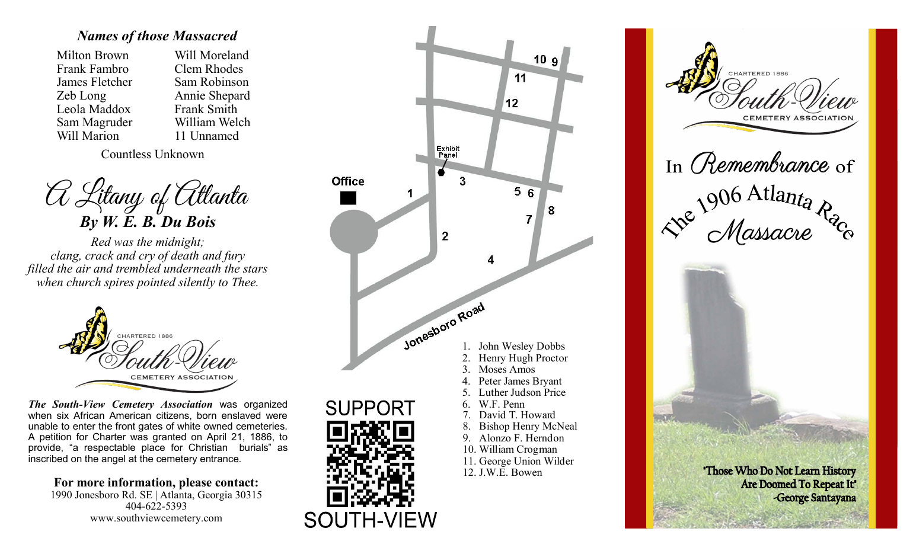
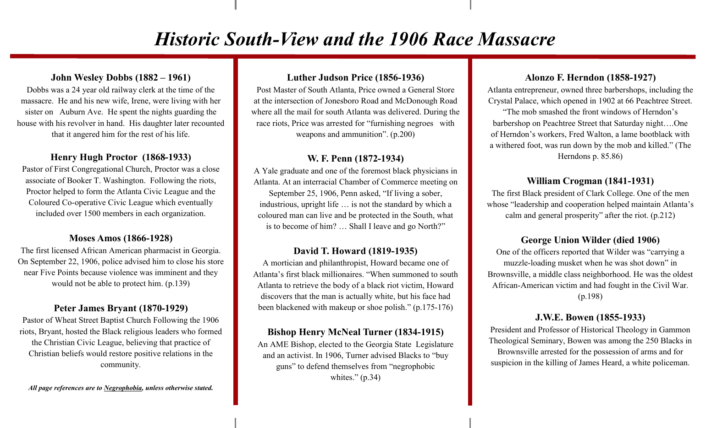

## Page 1, cover panel

In *Remembrance* of
The 1906 Atlanta Race *Massacre*

"Those Who Do Not Learn History Are Doomed To Repeat It"
-George Santayana

## Page 1, left panel

### Names of those Massacred

| | |
|---|---|
| Milton Brown | Will Moreland |
| Frank Fambro | Clem Rhodes |
| James Fletcher | Sam Robinson |
| Zeb Long | Annie Shepard |
| Leola Maddox | Frank Smith |
| Sam Magruder | William Welch |
| Will Marion | 11 Unnamed |

Countless Unknown

### A Litany of Atlanta
**By W. E. B. Du Bois**

*Red was the midnight;*
*clang, crack and cry of death and fury*
*filled the air and trembled underneath the stars*
*when church spires pointed silently to Thee.*

***The South-View Cemetery Association*** was organized when six African American citizens, born enslaved were unable to enter the front gates of white owned cemeteries. A petition for Charter was granted on April 21, 1886, to provide, "a respectable place for Christian burials" as inscribed on the angel at the cemetery entrance.

**For more information, please contact:**
1990 Jonesboro Rd. SE | Atlanta, Georgia 30315
404-622-5393
www.southviewcemetery.com

## Page 1, middle panel: map

A drawn map of the cemetery roads off Jonesboro Road, marking the Office, an "Exhibit Panel", and graves numbered 1 to 12:

1. John Wesley Dobbs
2. Henry Hugh Proctor
3. Moses Amos
4. Peter James Bryant
5. Luther Judson Price
6. W.F. Penn
7. David T. Howard
8. Bishop Henry McNeal
9. Alonzo F. Herndon
10. William Crogman
11. George Union Wilder
12. J.W.E. Bowen

SUPPORT [QR code] SOUTH-VIEW

## Page 2: Historic South-View and the 1906 Race Massacre

### John Wesley Dobbs (1882 – 1961)
Dobbs was a 24 year old railway clerk at the time of the massacre. He and his new wife, Irene, were living with her sister on Auburn Ave. He spent the nights guarding the house with his revolver in hand. His daughter later recounted that it angered him for the rest of his life.

### Henry Hugh Proctor (1868-1933)
Pastor of First Congregational Church, Proctor was a close associate of Booker T. Washington. Following the riots, Proctor helped to form the Atlanta Civic League and the Coloured Co-operative Civic League which eventually included over 1500 members in each organization.

### Moses Amos (1866-1928)
The first licensed African American pharmacist in Georgia. On September 22, 1906, police advised him to close his store near Five Points because violence was imminent and they would not be able to protect him. (p.139)

### Peter James Bryant (1870-1929)
Pastor of Wheat Street Baptist Church Following the 1906 riots, Bryant, hosted the Black religious leaders who formed the Christian Civic League, believing that practice of Christian beliefs would restore positive relations in the community.

### Luther Judson Price (1856-1936)
Post Master of South Atlanta, Price owned a General Store at the intersection of Jonesboro Road and McDonough Road where all the mail for south Atlanta was delivered. During the race riots, Price was arrested for "furnishing negroes with weapons and ammunition". (p.200)

### W. F. Penn (1872-1934)
A Yale graduate and one of the foremost black physicians in Atlanta. At an interracial Chamber of Commerce meeting on September 25, 1906, Penn asked, "If living a sober, industrious, upright life … is not the standard by which a coloured man can live and be protected in the South, what is to become of him? … Shall I leave and go North?"

### David T. Howard (1819-1935)
A mortician and philanthropist, Howard became one of Atlanta's first black millionaires. "When summoned to south Atlanta to retrieve the body of a black riot victim, Howard discovers that the man is actually white, but his face had been blackened with makeup or shoe polish." (p.175-176)

### Bishop Henry McNeal Turner (1834-1915)
An AME Bishop, elected to the Georgia State Legislature and an activist. In 1906, Turner advised Blacks to "buy guns" to defend themselves from "negrophobic whites." (p.34)

### Alonzo F. Herndon (1858-1927)
Atlanta entrepreneur, owned three barbershops, including the Crystal Palace, which opened in 1902 at 66 Peachtree Street. "The mob smashed the front windows of Herndon's barbershop on Peachtree Street that Saturday night….One of Herndon's workers, Fred Walton, a lame bootblack with a withered foot, was run down by the mob and killed." (The Herndons p. 85.86)

### William Crogman (1841-1931)
The first Black president of Clark College. One of the men whose "leadership and cooperation helped maintain Atlanta's calm and general prosperity" after the riot. (p.212)

### George Union Wilder (died 1906)
One of the officers reported that Wilder was "carrying a muzzle-loading musket when he was shot down" in Brownsville, a middle class neighborhood. He was the oldest African-American victim and had fought in the Civil War. (p.198)

### J.W.E. Bowen (1855-1933)
President and Professor of Historical Theology in Gammon Theological Seminary, Bowen was among the 250 Blacks in Brownsville arrested for the possession of arms and for suspicion in the killing of James Heard, a white policeman.

***All page references are to <u>Negrophobia</u>, unless otherwise stated.***
