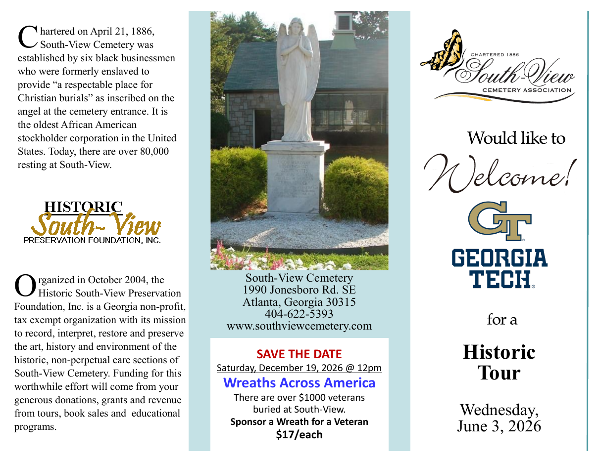
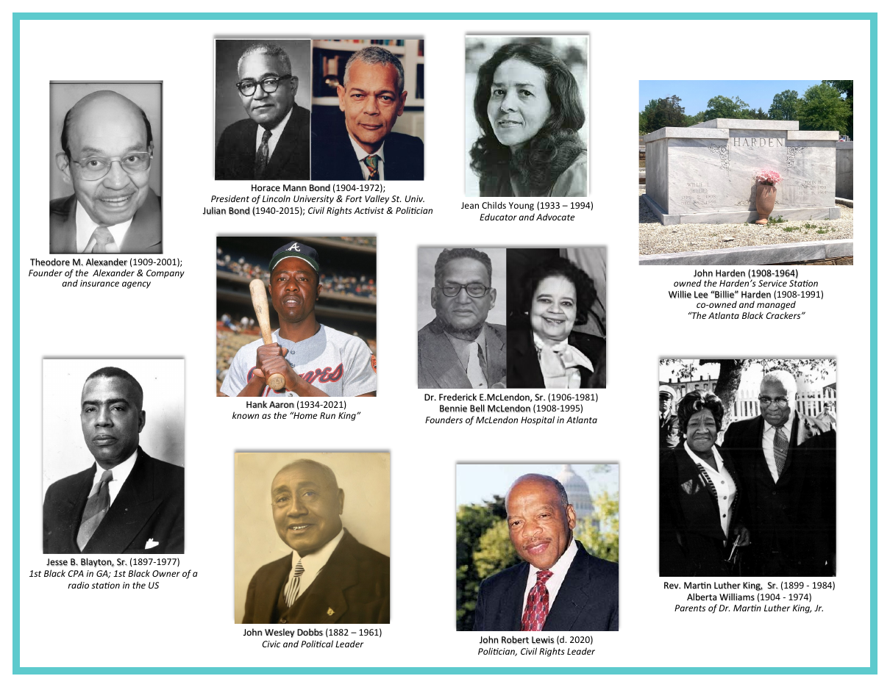

## Page 1, cover panel

South-View Cemetery Association
Would like to *Welcome!*
Georgia Tech
for a
**Historic Tour**
Wednesday, June 3, 2026

## Page 1, left panel

Chartered on April 21, 1886, South-View Cemetery was established by six black businessmen who were formerly enslaved to provide "a respectable place for Christian burials" as inscribed on the angel at the cemetery entrance. It is the oldest African American stockholder corporation in the United States. Today, there are over 80,000 resting at South-View.

Organized in October 2004, the Historic South-View Preservation Foundation, Inc. is a Georgia non-profit, tax exempt organization with its mission to record, interpret, restore and preserve the art, history and environment of the historic, non-perpetual care sections of South-View Cemetery. Funding for this worthwhile effort will come from your generous donations, grants and revenue from tours, book sales and educational programs.

## Page 1, middle panel

[Photo: the angel statue at the cemetery entrance]

South-View Cemetery
1990 Jonesboro Rd. SE
Atlanta, Georgia 30315
404-622-5393
www.southviewcemetery.com

**SAVE THE DATE**
Saturday, December 19, 2026 @ 12pm
**Wreaths Across America**
There are over $1000 veterans buried at South-View.
**Sponsor a Wreath for a Veteran**
**$17/each**

## Page 2: portraits

| Name and dates as printed | Caption as printed |
|---|---|
| Theodore M. Alexander (1909-2001) | Founder of the Alexander & Company and insurance agency |
| Horace Mann Bond (1904-1972) | President of Lincoln University & Fort Valley St. Univ. |
| Julian Bond (1940-2015) | Civil Rights Activist & Politician |
| Jean Childs Young (1933 – 1994) | Educator and Advocate |
| John Harden (1908-1964) | owned the Harden's Service Station |
| Willie Lee "Billie" Harden (1908-1991) | co-owned and managed "The Atlanta Black Crackers" |
| Jesse B. Blayton, Sr. (1897-1977) | 1st Black CPA in GA; 1st Black Owner of a radio station in the US |
| Hank Aaron (1934-2021) | known as the "Home Run King" |
| Dr. Frederick E.McLendon, Sr. (1906-1981) | Founders of McLendon Hospital in Atlanta |
| Bennie Bell McLendon (1908-1995) | Founders of McLendon Hospital in Atlanta |
| John Wesley Dobbs (1882 – 1961) | Civic and Political Leader |
| John Robert Lewis (d. 2020) | Politician, Civil Rights Leader |
| Rev. Martin Luther King, Sr. (1899 - 1984) | Parents of Dr. Martin Luther King, Jr. |
| Alberta Williams (1904 - 1974) | Parents of Dr. Martin Luther King, Jr. |

The Harden panel is a photo of the HARDEN mausoleum, not a portrait.
