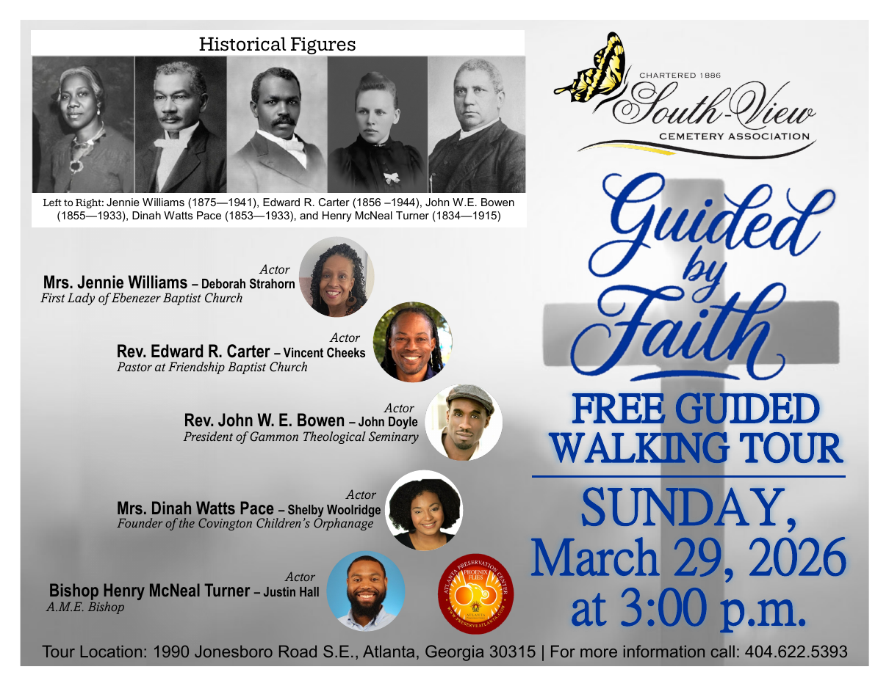

## Historical Figures

Left to Right: Jennie Williams (1875—1941), Edward R. Carter (1856 –1944), John W.E. Bowen (1855—1933), Dinah Watts Pace (1853—1933), and Henry McNeal Turner (1834—1915)

## Cast

| Historical figure | Role as printed | Actor |
|---|---|---|
| Mrs. Jennie Williams | First Lady of Ebenezer Baptist Church | Deborah Strahorn |
| Rev. Edward R. Carter | Pastor at Friendship Baptist Church | Vincent Cheeks |
| Rev. John W. E. Bowen | President of Gammon Theological Seminary | John Doyle |
| Mrs. Dinah Watts Pace | Founder of the Covington Children's Orphanage | Shelby Woolridge |
| Bishop Henry McNeal Turner | A.M.E. Bishop | Justin Hall |

## Event

*Guided by Faith*
FREE GUIDED WALKING TOUR
SUNDAY, March 29, 2026 at 3:00 p.m.

Tour Location: 1990 Jonesboro Road S.E., Atlanta, Georgia 30315 | For more information call: 404.622.5393
