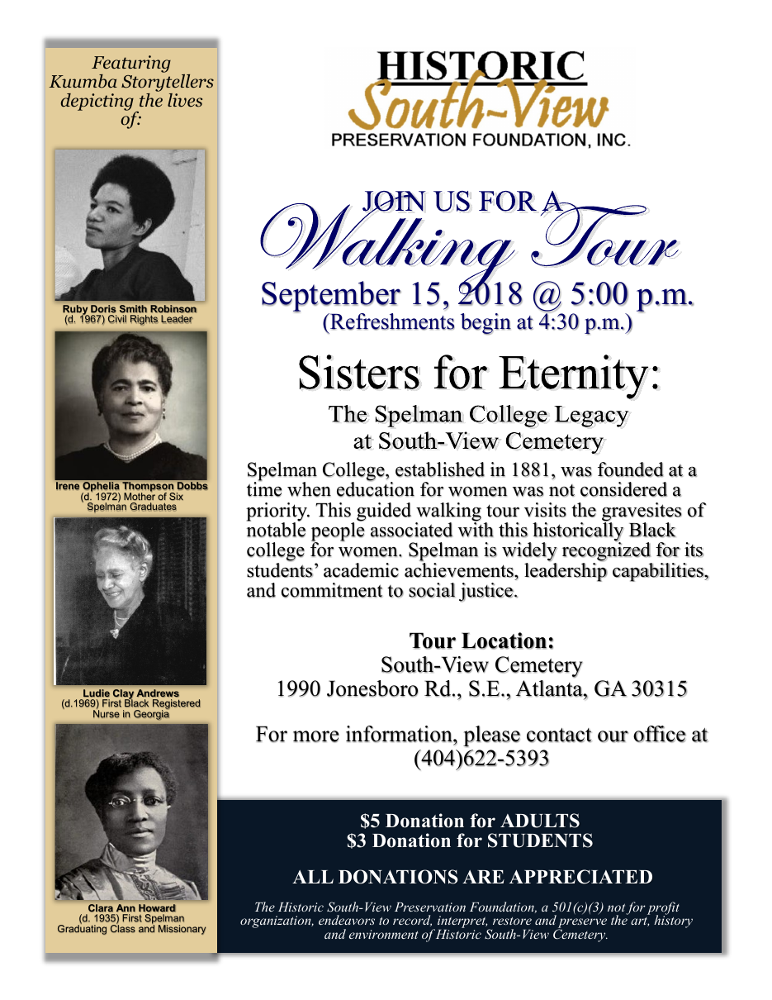

## Left column

*Featuring Kuumba Storytellers depicting the lives of:*

| Portrait | Caption as printed |
|---|---|
| Ruby Doris Smith Robinson | (d. 1967) Civil Rights Leader |
| Irene Ophelia Thompson Dobbs | (d. 1972) Mother of Six Spelman Graduates |
| Ludie Clay Andrews | (d.1969) First Black Registered Nurse in Georgia |
| Clara Ann Howard | (d. 1935) First Spelman Graduating Class and Missionary |

## Main text

JOIN US FOR A *Walking Tour*
September 15, 2018 @ 5:00 p.m.
(Refreshments begin at 4:30 p.m.)

**Sisters for Eternity:**
The Spelman College Legacy at South-View Cemetery

Spelman College, established in 1881, was founded at a time when education for women was not considered a priority. This guided walking tour visits the gravesites of notable people associated with this historically Black college for women. Spelman is widely recognized for its students' academic achievements, leadership capabilities, and commitment to social justice.

**Tour Location:**
South-View Cemetery
1990 Jonesboro Rd., S.E., Atlanta, GA 30315

For more information, please contact our office at (404)622-5393

**$5 Donation for ADULTS**
**$3 Donation for STUDENTS**
**ALL DONATIONS ARE APPRECIATED**

*The Historic South-View Preservation Foundation, a 501(c)(3) not for profit organization, endeavors to record, interpret, restore and preserve the art, history and environment of Historic South-View Cemetery.*
