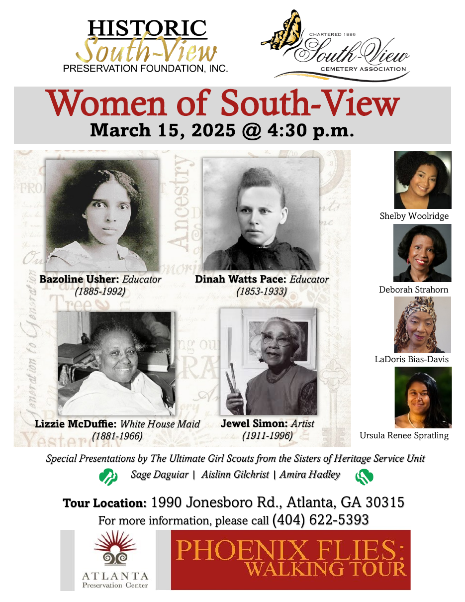

**Women of South-View**
March 15, 2025 @ 4:30 p.m.

## Portraits

| Name | Caption as printed |
|---|---|
| Bazoline Usher | Educator (1885-1992) |
| Dinah Watts Pace | Educator (1853-1933) |
| Lizzie McDuffie | White House Maid (1881-1966) |
| Jewel Simon | Artist (1911-1996) |

## Actors (headshots, right side)

Shelby Woolridge · Deborah Strahorn · LaDoris Bias-Davis · Ursula Renee Spratling

## Event

*Special Presentations by The Ultimate Girl Scouts from the Sisters of Heritage Service Unit*
*Sage Daguiar | Aislinn Gilchrist | Amira Hadley*

**Tour Location:** 1990 Jonesboro Rd., Atlanta, GA 30315
For more information, please call (404) 622-5393

PHOENIX FLIES: WALKING TOUR
