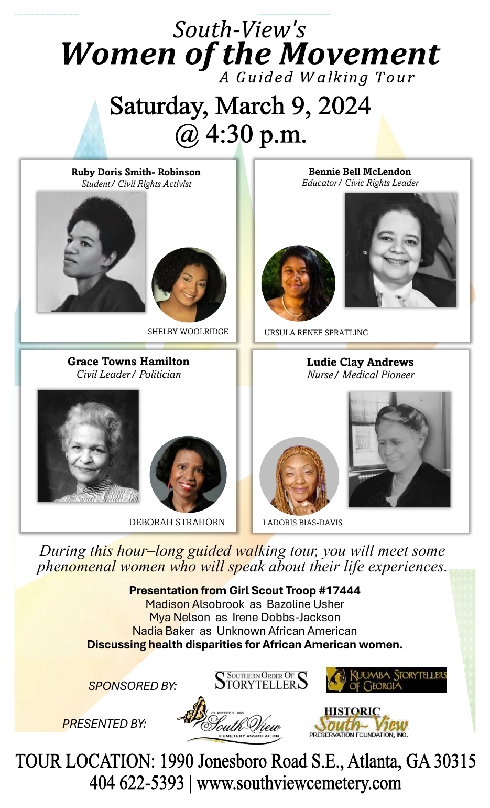

South-View's ***Women of the Movement***
*A Guided Walking Tour*
Saturday, March 9, 2024 @ 4:30 p.m.

## Cast

| Historical figure | Role as printed | Actor |
|---|---|---|
| Ruby Doris Smith- Robinson | Student/ Civil Rights Activist | Shelby Woolridge |
| Bennie Bell McLendon | Educator/ Civic Rights Leader | Ursula Renee Spratling |
| Grace Towns Hamilton | Civil Leader/ Politician | Deborah Strahorn |
| Ludie Clay Andrews | Nurse/ Medical Pioneer | LaDoris Bias-Davis |

*During this hour–long guided walking tour, you will meet some phenomenal women who will speak about their life experiences.*

**Presentation from Girl Scout Troop #17444**
Madison Alsobrook as Bazoline Usher
Mya Nelson as Irene Dobbs-Jackson
Nadia Baker as Unknown African American
**Discussing health disparities for African American women.**

SPONSORED BY: Southern Order of Storytellers · Kuumba Storytellers of Georgia
PRESENTED BY: South-View Cemetery Association · Historic South-View Preservation Foundation, Inc.

TOUR LOCATION: 1990 Jonesboro Road S.E., Atlanta, GA 30315
404 622-5393 | www.southviewcemetery.com
