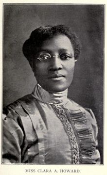

*Scene – Head down, Ms. Howard is working at a desk with dormitory charts and lists of student names. She’s preparing dorm arrangements for the entering class of Spelman Seminary students in 1901. She is the Dorm Matron having returned to Spelman two years earlier from missionary work in the Congo because of a bout with malaria.*

Greetings to the entering class of 1905! *(pronounced 19 ought 5)* I am Miss Howard, the dorm matron for the boarding students. Your room assignments will be given to you at the culmination of today’s dedication events. As Spelman women you will be expected to keep your rooms clean, beds made and manage yourselves with proper decorum. You may leave your belongings here. Now run on to the dedication ceremonies. Be on time!

(Look away as though the group of students ran off and you are speaking now in a less formal kind of whispering voice.) Will you look at the young girls of this entering class….so intelligent, beautiful and full of spirit. When they leave they will be Spelman women! I was enrolled at Spelman in 1881 and graduated at the top of the first graduating class in 1887. I taught in Atlanta for a few years and then was called to join the Women’s Baptist Foreign Missionary Society. That same year moved to Lukunga in the Congo, Africa. Nora Gordon, one of my Spelman classmates, had arrived two years before me. We worked together to start a school for the children of the Congo with 100 students. We witnessed tremendous development of the young women we taught. I nearly died from Malaria so I returned to Atlanta, but with me I brought my most promising student, Miss Flora Zeto Malekebu, to be educated at Spelman. Being an educator and a missionary have given me a full life. Sadly, Nora died at only 34 years old. I passed in my home at the age of 69. Along with Flora, we rest here in a lot purchased by Spelman Seminary. Many Congonese students followed Flora and my beloved Spelman named a dorm in my honor – the Howard-Herrald Hall! (look off into the future, pause, then back to the crowd) Off you go… there is so much work to be done. *(look back to the work on the desk and sit down)*

Prop Suggestions: Wire rimmed glasses, high collared blouse and long skirt, a cross and a bible, Poster of Africa, blueprints of a dorm, a list of student’s names, a desk and old fashioned pen, desk and chair, books on a book shelf.

***\***
