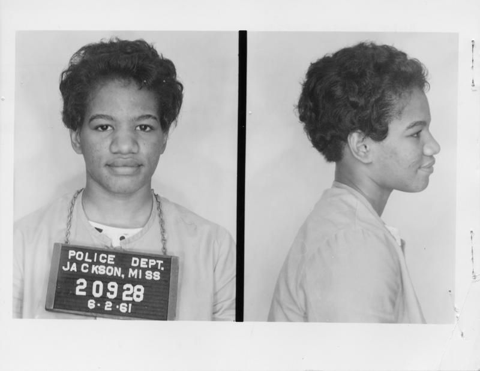

*Setting: Standing behind the counter at the Gate City Drug Store, taking inventory of the medicines on the shelf.*

Hey, hand me that next poster board. I’m about done with this one. Did you get in touch with John? (to the person on the phone) Yes, I’ll stop by there in the morning, thanks… (She hangs up the phone, looks up and notices the crowd.) Oh hi. Come on in. This is the office of the Student Nonviolence Coordinating Committee, better known as SNCC. I’m Ruby Doris Smith Robinson, the new Executive Secretary. We have a lot going on here preparing for the next sit in and protest. We are working to tear down Jim Crow, and ….its working….little by little.

I was born here in Atlanta and grew up in the Summerhill neighborhood, over on Frazier Street, not far from here. I have 6 brothers and sisters. I’m second to the oldest. Growing up, I hardly ever saw white people. I knew I was black and about racism, but I didn’t have to deal with it every day. My neighborhood, my friends, the stores we shopped in, my schools, our church…were all black. Not having to deal with racism all the time let me just be a kid. My parents worked hard running their own businesses. My mom ran a beauty shop and my dad ran a store, a restaurant, drove a cab…. He was also a minister and founded our church when I was in high school. For the most part, their businesses were connected to our house, so they were always around to take care of us. Once, my mom let me and my sister, Catherine, go to a drug store up on Capitol Avenue to get ice cream cones. I noticed that the white lady scooping the ice cream used a napkin when she pulled the cones down for the white customers. But when she pulled the cones down for me and my sister, she touched them with her bare hands. She brought the cones over for me to pay for and I told her I wouldn’t be buying those cones. She said “But you ordered them”. I didn’t care, I wasn’t going to be treated like that. She thought because I was a black kid she could treat me any way she wanted. I guess I have always stood up for what is right. It’s just a part of who I am.

When I was about 13, I watched the Montgomery Bus Boycott on television. I saw the water hoses pushing kids down, the grown people walking to work instead of riding the busses and I saw the effect of the Boycott on the city. It worked! It changed things! My teachers taught us about Brown v. Board of Education and we saw kids our age in Little Rock Arkansas integrating Central High School. I knew then that I wanted to work to end Jim Crow segregation ….and that we CAN end it. I graduated from Price High School when I was 16 and was accepted to Spelman College. In my freshman year, I joined the Atlanta Student Movement and participated in demonstrations and sit ins to desegregate Atlanta. We sat in at the State Capitol, Grady Hospital and Riches Department Store. Grady served sick people of both races, but they had separate doors! A group of us went to protest the separate entrances at Grady and In 1961, at Shaw University in Raleigh, SNCC was Founded. It is a national organization that strategizes to coordinate a movement for students to participate in. We have members in North and South Carolina, Alabama, Mississippi and all over the south, mostly in cities and towns with colleges in them. We find what works and what fails, and we shape our movement to be as effective as possible.

At first, when students were arrested, we were bailed out with donations from the community. That was expensive, and the local governments benefited from the payment. SNCC developed a strategy called “jail no bail”. I went with a group to protest in Rock Hill, SC. We were arrested and sentenced to thirty days in jail. Instead of paying for our release, we all stayed and served out our sentences. My sister, Mary Ann, was supposed to go to Rock Hill instead of me, but I talked her out of it. I joined the Freedom Riders in 1961. Our mission was to disband the segregation laws on interstate transit. I dodged mob violence and was jailed for 45 days in Mississippi. I was made to work on the chain gang at but I completed the sentence ….and I’d do it again. I always volunteer for the most hazardous responsibilities because I know that I can do them. My friends in the movement say I am bold and daring. I am assertive, but truly I am empowered because this work is so necessary. I will die working for this cause.

By the second semester of my junior year, I was working full time on the movement and I decided to drop out of school. I knew how important earning my degree was, so I reapplied to return to Spelman the next fall. Several recommendations were required with the reapplication, and Dr. Martin Luther King, Jr. was nice enough to right one for me. I returned to school and completed my degree. The Freedom Fighters granted me a \$200 scholarship to help with the cost.

In 1964, I married Clifford Robinson and we had a beautiful baby boy. I continued to work for SNCC and was elected its first female Executive Director following Jim Foreman. I organized SNCC,- made sure the Freedom Singers travel arrangements were scheduled and that the field staff had cars. We organized the Sojourner Truth Motor Fleet as a separate entity to provide the cars. I ran many of the other programs as well. The movement needed me. Stokely Carmichael lead the organization at that time. Shortly thereafter, I was diagnosed with leukemia and I died in 1967.

I really must get back to work. Stay strong in the struggle my friends. Remember: If you think free, you are free.
